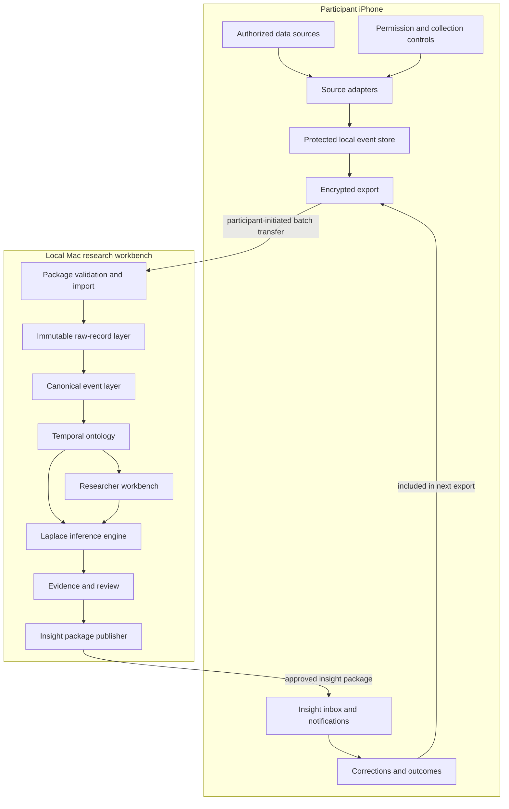

# System architecture

## Architectural goals

- Native access to explicitly authorized iPhone data
- Local-first handling of identifiable personal records
- Participant-controlled batch transfer in V1
- Strictly isolated participant workspaces
- Source provenance from raw record to notification
- Extensible source connectors and inference methods
- A temporal ontology rather than a collection of disconnected dashboards
- A path to continuous synchronization without requiring it initially

## Conceptual architecture

## iPhone application

### Source adapters

Each source adapter translates one authorized API into a canonical event envelope while retaining the original source representation or a lossless source reference.

Initial adapters:

- Core Location
- Core Motion
- HealthKit
- EventKit
- Screen Time/Device Activity, subject to technical feasibility

Future adapters may include PhotoKit metadata, Safari/share extensions, account APIs, and participant-provided files.

### Local event store

The local store should support:

- append-oriented observations;
- source-specific checkpoints;
- event time and ingestion time;
- deduplication keys;
- permission/consent references;
- protected storage while the device is locked;
- deletion by source and date range; and
- export manifests and integrity hashes.

A concrete database and encryption design remain open technical decisions.

### Export package

V1 uses participant-initiated batch export rather than continuous upload. A package should eventually contain:

- manifest and schema version;
- participant/workspace identifier;
- selected date range and source categories;
- consent and purpose metadata;
- canonical events;
- source records or references needed for provenance;
- integrity hashes; and
- encryption metadata.

The exact key exchange and package format require a dedicated design decision after feasibility work.

## Mac research workbench

### Workspace isolation

Every participant receives a separate logical and cryptographic workspace. Shared inference code can run against multiple workspaces, but records and ontology objects are not merged.

### Data layers

1. **Raw layer:** original imported records, immutable except for authorized deletion.
2. **Canonical layer:** normalized events with common time, source, actor, and provenance fields.
3. **Ontology layer:** typed objects, properties, links, events, evidence, and actions.
4. **Inference layer:** hypotheses, models, predictions, confidence, review, and outcomes.
5. **Presentation layer:** maps, timelines, graphs, dossiers, forecasts, and insight packages.

Keeping these layers separate prevents a model-generated interpretation from silently becoming a raw fact.

### Researcher interfaces

The workbench should eventually support:

- timeline and event-table exploration;
- map and repeated-place exploration;
- ontology graph navigation;
- source and provenance inspection;
- feature and correlation exploration;
- inference definition, execution, and versioning;
- prediction locking and evaluation;
- evidence review; and
- participant insight publishing.

## Laplace integration

Laplace is model-agnostic. It should expose stable interfaces for:

- deterministic rules;
- statistical analyses;
- unsupervised clustering;
- time-series forecasts;
- local language models; and
- external AI providers, if later authorized.

A language model output is stored as a hypothesis or interpretation, never as an observed fact. External model use is deferred and must not become a hidden dependency of the ontology.

## Returning insights to the participant

Because V1 has no continuous server, the workbench creates an approved insight package. The participant imports it into the iPhone application, which can:

- display the conclusion and evidence summary;
- schedule an appropriate local notification;
- ask whether the conclusion is accurate or useful;
- propose a participant-controlled experiment; and
- capture corrections and outcomes for the next export.

## Platform feasibility map

This table describes the conceptual boundary and must be validated against the target iOS/Xcode version.

| Data category | Expected path | Important constraint |
|---|---|---|
| Location | Core Location | Explicit authorization; background behavior and battery impact require testing |
| Motion/activity | Core Motion | Device support and authorization vary by signal |
| Sleep/activity | HealthKit | Permission is granular by data type; absence of data is not proof of denial |
| Calendar/reminders | EventKit | Explicit authorization; records may contain information about nonparticipants |
| Screen usage | Family Controls/Device Activity | Entitlements and privacy-preserving APIs may limit accessible detail |
| Photos metadata | PhotoKit | Selected/full-library authorization; may expose third-party information |
| Browser activity | Deliberate share/Safari extension or account export | No unrestricted global browser-history access |
| Calls and SMS | None for an ordinary iOS app | Not available as general device history |
| Other app contents | Service API/export only | iOS sandbox prevents arbitrary access |
| Historical platform data | Participant-provided export | Availability and schemas vary by provider and account |

Sideloading removes App Store distribution as a V1 requirement; it does not remove operating-system permissions or sandboxing.

## Trust boundaries

1. **iPhone boundary:** source data is available only after OS and participant authorization.
2. **Export boundary:** the participant deliberately selects and transfers a package.
3. **Researcher boundary:** identifiable raw data becomes visible to the authorized researcher.
4. **Inference boundary:** generated hypotheses are separated from observations until validated.
5. **Publication boundary:** only reviewed conclusions become participant-facing insights.
6. **External-model boundary:** deferred; requires separate authorization and provider evaluation.

See [Trust and data governance](trust-and-data-governance.md) for the governing requirements.

## Open technical decisions

- Minimum supported iOS and macOS versions
- Exact Screen Time feasibility and entitlement needs
- iPhone database and at-rest encryption design
- Export encryption and key exchange
- Canonical event serialization format
- Mac database/graph representation
- Local browser UI versus packaged desktop UI
- Python backend and analysis framework
- Insight package signing and replay protection
- Local-model hardware targets
- Continuous synchronization protocol after V1
