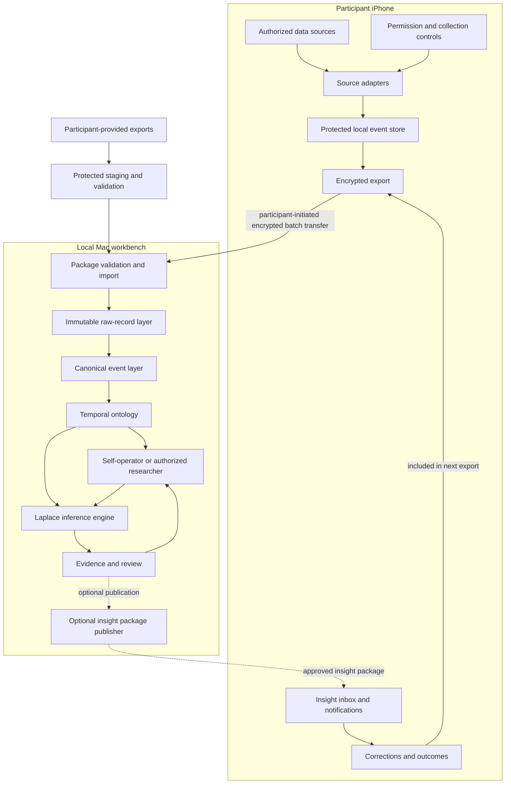

# System architecture

## Architectural goals

- Native access to explicitly authorized iPhone data
- Local-first handling of identifiable personal records
- Participant-controlled batch transfer in V1
- Strictly isolated participant workspaces
- Self-operated exploration and separately authorized researcher-assisted use
- Source provenance from original record to displayed finding
- Extensible source connectors and inference methods, including participant-provided imports
- A personal dashboard backed by a connected temporal ontology rather than isolated charts
- A path to continuous synchronization without requiring it initially

## Conceptual architecture

The core experience ends at the local explorer and its evidence views; phone publication is optional. The participant may operate their own workspace. Moving data to a separate researcher's Mac is an additional, explicitly authorized sharing boundary, not a prerequisite for self-use. Local corrections are captured by the workbench as well as through any later phone feedback path.

This is a conceptual decomposition, not a choice of frameworks, database, export cryptography, or deployment target. Follow [the collection protocol](collection-probe.md) before native scaffolding or real-data transfer.

## iPhone application

### Source adapters

Each source adapter translates an authorized API into a minimal source-aware representation while retaining the original source representation or a lossless source reference. Preserve point, interval, and aggregate semantics; an aggregate count must not become invented individual events.

Initial adapters:

- Core Location
- Core Motion
- HealthKit
- EventKit
- Screen Time/Device Activity, subject to technical feasibility

The collection lab also tests participant-provided App Privacy Report files and one relevant account export, using importer paths rather than pretending they are automatic iPhone APIs. Future adapters may include PhotoKit metadata, Safari/share extensions, spending exports, and additional account APIs. Detailed scrolling and content visibility require source-specific evidence.

### Local event store

The local store should support:

- append-oriented observations;
- source-specific checkpoints;
- event time and ingestion time;
- deduplication keys;
- permission/consent references;
- an explicit, tested data-protection policy, including what remains readable/writable while locked;
- deletion by source and date range; and
- export manifests and integrity hashes.

A concrete database and encryption design remain open technical decisions.

### Export package

V1 uses participant-initiated batch export rather than continuous upload. A package should eventually contain:

- manifest and schema version;
- participant/workspace identifier;
- selected date range and source categories;
- consent and purpose metadata;
- canonical events;
- source records or references needed for provenance;
- integrity hashes; and
- encryption metadata.

The exact key exchange and package format require a dedicated design decision after synthetic format exploration and before any real-data export/import. Device feasibility tests must satisfy the storage and transfer gates appropriate to the data they handle; a technical spike is not an exemption.

## Local Mac workbench

### Workspace isolation

Strict participant workspace isolation is required. Shared inference code can run against multiple workspaces, but records and ontology objects are not merged. Logical access checks, at-rest protection, cryptographic separation, and key handling need a concrete design and adversarial tests; they are not implemented guarantees. Test with synthetic workspaces until the relevant real-data controls are established. See [trust and data governance](trust-and-data-governance.md).

### Data layers

1. **Raw layer:** original imported records, immutable except for authorized deletion.
2. **Canonical layer:** normalized events with common time, source, actor, and provenance fields.
3. **Ontology layer:** typed objects, properties, links, events, evidence, and actions.
4. **Inference layer:** hypotheses, models, predictions, confidence, review, and outcomes.
5. **Presentation layer:** coverage views, timelines, linked objects, and evidence-backed findings; maps, profiles, forecasts, and insight packages can extend the first slice.

Keeping these layers separate prevents a model-generated interpretation from silently becoming a raw fact.

### Operator interfaces

Self-operators and authorized researchers use the same analytical capabilities within their respective access scopes. The workbench should eventually support:

- timeline and event-table exploration;
- map and repeated-place exploration;
- ontology graph navigation;
- source coverage, missingness, freshness, and provenance inspection;
- local participant corrections and their downstream effects;
- feature and correlation exploration;
- inference definition, execution, and versioning;
- prediction locking and evaluation;
- evidence review; and
- participant insight publishing.

## Laplace integration

Laplace is model-agnostic. It should expose stable interfaces for:

- deterministic rules;
- statistical analyses;
- unsupervised clustering;
- time-series forecasts;
- local language models; and
- external AI providers, if later authorized.

A language model output is stored as a hypothesis or interpretation, never as an observed fact. External model use is deferred and must not become a hidden dependency of the ontology.

## Optional phone insight loop

In the core design, the participant inspects results directly in the local workbench. If a phone experience is added, the workbench can create an approved insight package rather than introducing a continuous server. The participant imports it into the iPhone application, which can:

- display the conclusion and evidence summary;
- schedule an appropriate local notification;
- ask whether the conclusion is accurate or useful;
- propose a participant-controlled experiment; and
- capture corrections and outcomes for the next export.

## Platform feasibility map

This table describes the conceptual boundary and must be validated against the target iOS/Xcode version.

| Data category | Expected path | Important constraint |
|---|---|---|
| Location | Core Location | Explicit authorization; background behavior and battery impact require testing |
| Motion/activity | Core Motion | Device support and authorization vary by signal |
| Sleep/activity and other available Health records | HealthKit | Permission is granular; data needs an actual producer; absence is not proof of read denial |
| Calendar/reminders | EventKit | Explicit authorization; records may contain information about nonparticipants |
| App-resource and contacted-domain metadata | Participant-exported App Privacy Report | Rolling windows and aggregates; not payloads, exact consumption, or proof of company profiling |
| Screen usage report | Family Controls/Device Activity report extension | Restricted presentation context, not permission to move sensitive report data to the Mac |
| Screen usage export | Newer entitled activity-data export API | Documented from iOS 26.4; authorization, provisioning, and development/customer regional rules must be tested |
| Photos metadata | PhotoKit | Selected/full-library authorization; may expose third-party information |
| Browser activity | Deliberate share/Safari extension or account export | No unrestricted global browser-history access |
| Calls and SMS | None for an ordinary iOS app | Not available as general device history |
| Other app contents | Service API/export only | iOS sandbox prevents arbitrary access |
| Historical platform data | Participant-provided export | Availability and schemas vary by provider and account |
| Spending context | Participant-provided transaction export | Optional; no general cross-app transaction-history access is assumed |
| Native-app scrolling, taps, and feed dwell | Source-specific export/API or explicitly instrumented surface, if available | No device-wide access from an unrelated collector is established |

Sideloading removes App Store distribution as a V1 requirement; it does not remove operating-system permissions or sandboxing. See [the dated first-party reference checks](review-and-next-steps.md#4-reference-checked-collection-boundaries). In particular, development testing in Canada must not be presented as proof of customer access to an EU-restricted export API.

## Trust boundaries

1. **iPhone boundary:** source data is available only after OS and participant authorization.
2. **Export boundary:** the participant deliberately selects and transfers a package.
3. **Operator boundary:** self-use remains within the participant's control; identifiable raw data becomes visible to a separate researcher only under explicit sharing authorization.
4. **Inference boundary:** generated hypotheses remain separate from observations. Exploratory results can be inspected with provisional labels, not presented as established conclusions.
5. **Publication boundary:** promoted insights require evidence review appropriate to their consequence; a separate researcher is not required for ordinary self-exploration.
6. **External-model boundary:** deferred; requires separate authorization and provider evaluation.

See [Trust and data governance](trust-and-data-governance.md) for the governing requirements.

## Open technical decisions

- Minimum supported iOS and macOS versions
- Exact Screen Time feasibility and entitlement needs
- iPhone database and at-rest encryption design
- Export encryption and key exchange
- Canonical event serialization format
- Mac database/graph representation
- Local browser UI versus packaged desktop UI
- Python backend and analysis framework
- Insight package signing and replay protection
- Local-model hardware targets
- Continuous synchronization protocol after V1
